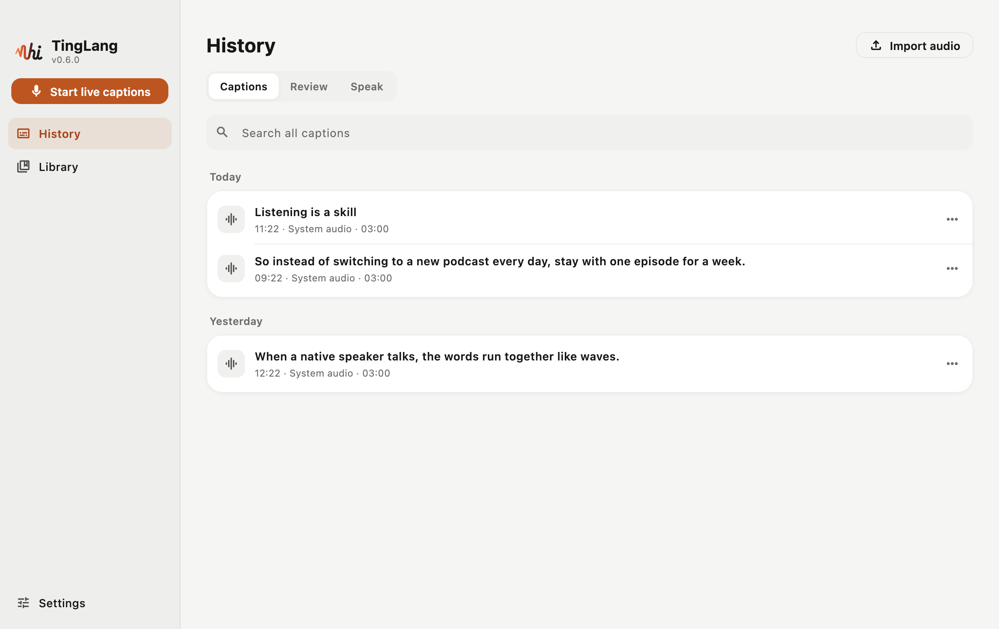
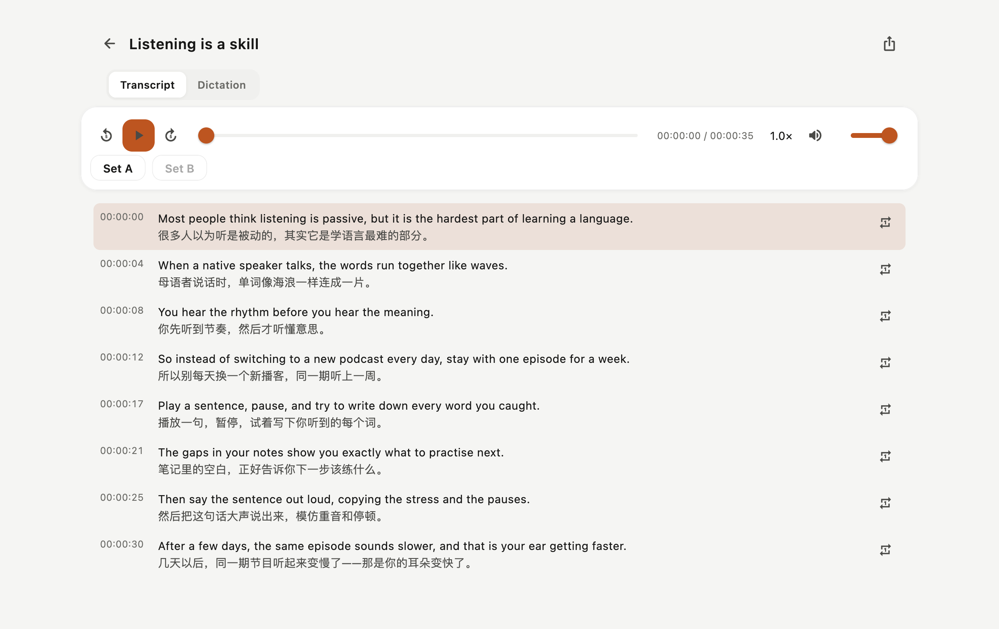
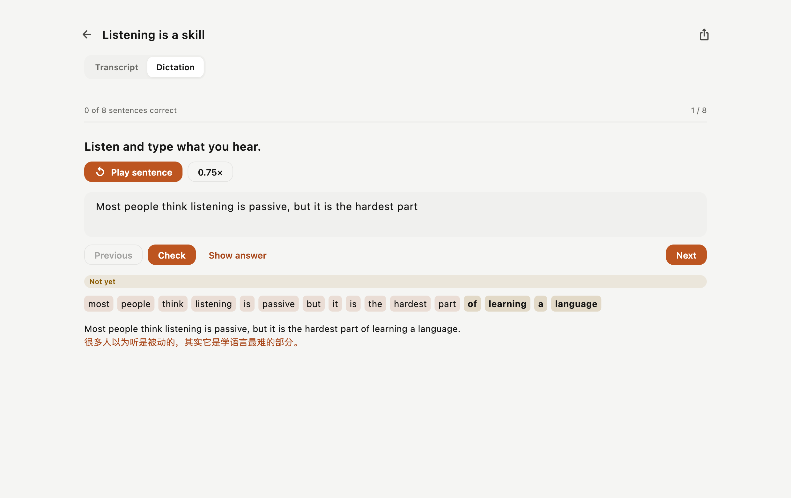
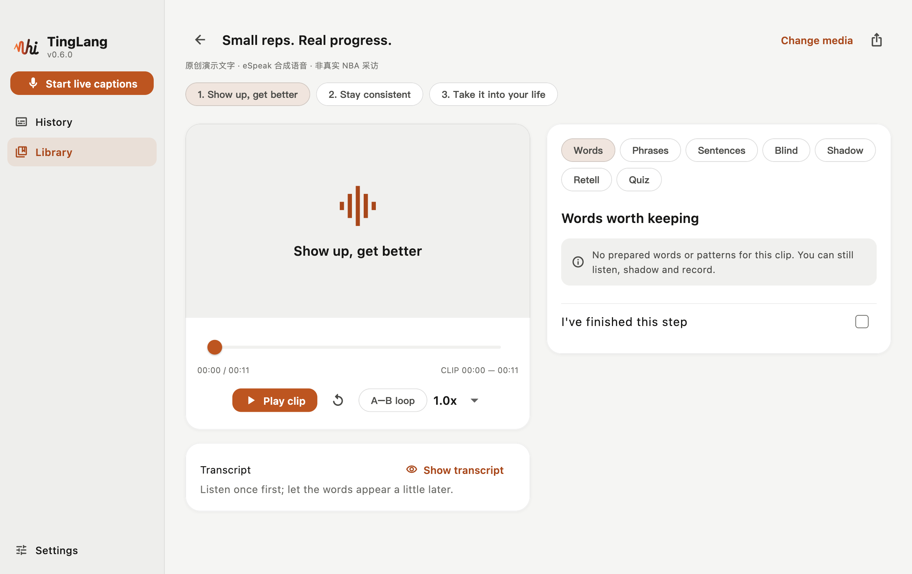
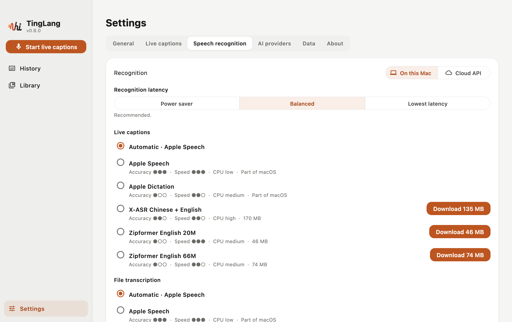
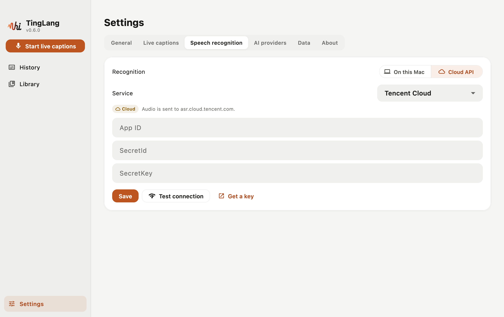
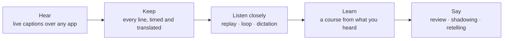

<div align="center">
  <picture>
    <source media="(prefers-color-scheme: dark)" srcset="assets/brand/svg/tinglang-mark-dark.svg">
    
  </picture>
  <h1>TingLang · 听浪</h1>
  <p><strong>Every sentence is a wave. Catch it.</strong></p>
  <p>Live captions over anything your Mac plays, then close listening, dictation, a course of your own and speaking — all from what you already listen to.</p>
  <p><strong>English</strong> · <a href="readmes/README.zh-CN.md">简体中文</a></p>
  <p>
    <a href="https://github.com/eeeease/TingLang/releases/latest"></a>
    
    <a href="#licence"></a>
    
  </p>
  <p>
    <a href="#-features">Features</a> ·
    <a href="#-download">Download</a> ·
    <a href="#-privacy-and-your-data">Privacy</a> ·
    <a href="docs/BUILDING.md">Build from source</a> ·
    <a href="docs/KNOWN_LIMITATIONS.md">Known limitations</a>
  </p>
</div>

---

## 🌊 Why "TingLang"

**听浪 (Tīng Làng) means "listening to the waves."** Sound travels in waves, and that is how English reaches you every day: wave after wave in podcasts, matches, games, films and meetings — mostly too fast to catch.

TingLang catches them for you. A small floating panel captions whatever your Mac is playing, puts a translation under every line and keeps every sentence. Later you replay them one wave at a time, write them down from memory, turn them into a short course and say them in your own words — until one day the same episode sounds slower. The speakers did not slow down; your ear got faster.

Plainly put: TingLang is a Mac app for learning English from what you already listen to. It is local-first — no account, no tracking — and recognises speech on your Mac, or with a cloud service and your own key if your Mac cannot run the models.

## 📸 Screenshots

<table>
  <tr>
    <td align="center"><br><sub>Every caption session, kept line by line</sub></td>
    <td align="center"><br><sub>Sentence by sentence, with the translation</sub></td>
  </tr>
  <tr>
    <td align="center"><br><sub>Dictation, graded word by word</sub></td>
    <td align="center"><br><sub>A course from what you heard</sub></td>
  </tr>
  <tr>
    <td align="center"><br><sub>Models on your Mac, rated by accuracy, speed and CPU</sub></td>
    <td align="center"><br><sub>Or a cloud API with your own key</sub></td>
  </tr>
</table>

## ✨ Features

- 🌊 **Live bilingual captions over anything**: system audio or the microphone, in a floating panel above every app and full-screen video. Card or desktop-lyrics style, stacked or side by side, lock it so clicks pass through, scroll back. ⌘⇧T starts and stops.
- 🎧 **Sentence by sentence**: every session is kept line by line with times and translations (and the audio, if you like). Replay, 0.6–1.5× speed, A–B loops, tap a line to jump to it; search everything; export SRT, VTT or TXT.
- ✍️ **Dictation that grades you**: type what you hear; each sentence is marked correct, close or wrong, with a word-by-word diff.
- 🧩 **A course from what you heard**: one click picks words above your level, phrases, blanks for blind listening, shadowing passages, a retelling outline and a quiz. Basic courses are made offline; AI courses use a provider you add (18 presets, local Ollama and LM Studio included), with the cost estimated first and every quote checked against the transcript.
- 🔁 **Spaced review**: FSRS-6 brings the expressions you saved back just before you would forget them.
- 🗣️ **Say it yourself**: record yourself, compare with the original, keep your notes.
- 🔒 **On your Mac, or your own cloud**: Apple's speech recognition on macOS 26; open models you download once on macOS 14.2+ (rated by accuracy, speed and CPU); or a cloud API with your own key — Tencent Cloud, Alibaba Cloud Model Studio, iFlytek, Soniox, AssemblyAI or Azure AI Speech.
- 📦 **TingLang packages**: a course with its audio, or a recording, as one `.tinglang` file to send to a friend; double-click it to import.
- ☁️ **iCloud Drive sync** (off by default): your library and progress on every Mac signed in to the same Apple ID; macOS does the syncing, the database never leaves your Mac.
- 👤 **A TingLang account, optional**: sign in with email, Google or GitHub to see your plan and usage; plans are bought and managed on [tinglang.app](https://tinglang.app). TingLang's own cloud transcription is coming soon.
- 🔄 **Updates in the app**: when a new release is out, update and restart from the banner (the daily check can be turned off).
- 📱 **Voice Memos**: recordings from your iPhone show up and are transcribed by the time they were made.
- 🌐 English and Simplified Chinese interface.

## 🧠 How it works



## 📥 Download

Download `Tinglang-<version>-macOS.zip` from the [latest release](https://github.com/eeeease/TingLang/releases/latest), unzip it and move **Tinglang** to Applications. It runs on macOS 14.2 or later, on Apple silicon and Intel.

The app is not signed or notarised yet, so macOS refuses to open it the first time (the message offers only Done and Move to Trash: choose Done). Open it once, then choose **System Settings → Privacy & Security → Open Anyway** (or run `xattr -dr com.apple.quarantine /Applications/Tinglang.app` in Terminal). Each release lists the zip's SHA-256 so you can check it with `shasum -a 256`. After that, TingLang tells you when a new version is out and can install it for you (it checks the zip's SHA-256 first).

### First run

Only the floating panel appears. Play something in English and press the orange record button (or ⌘⇧T). If nothing can recognise speech yet, TingLang asks how you want it done — a model on this Mac (one download) or a cloud API — in Settings → Speech recognition. The first time, macOS asks whether TingLang may record system audio. Stop, and **View** opens the sentence-by-sentence page; the Dock icon opens the main window.

For a sample course, open **Library → Mine → Load the sample course**. It is original text with about 36 seconds of synthetic speech, not a real interview or a copyrighted video.

## 🛠 Build from source

You need macOS 14.2 or later, Xcode 26 or later, [fvm](https://fvm.app) and Python 3.10+.

```bash
git clone https://github.com/eeeease/TingLang.git
cd TingLang
fvm install
bash scripts/run_macos.sh
```

Toolchain details, signing with your own team, checks, versions and releases are in [docs/BUILDING.md](docs/BUILDING.md). What has actually been built and run on a Mac is recorded in [docs/VERIFICATION.md](docs/VERIFICATION.md), including what has not.

## 🔐 Privacy and your data

- Everything lives in one folder on your Mac (Settings shows the exact path):

  ```text
  ~/Library/Application Support/dev.eeeease.tinglang/Tinglang/
  ├── tinglang.sqlite  # sessions, courses, drafts, practice, review, settings
  ├── media/           # media copied into the app
  ├── models/          # speech models you downloaded (delete them in Settings)
  └── recordings/      # your own recordings (WAV)
  ```

- Apart from the update check below, TingLang goes online only for things you turned on, each labelled where it runs: a cloud speech service you chose (audio goes to that service), AI providers you added (when you generate a course or test the connection), speech model downloads you approved, YouTube clips in the official embedded player, and a TingLang server after you sign in to it. Keys stay in the macOS Keychain.
- **Update check (on by default):** once a day TingLang asks GitHub (api.github.com) whether a newer release is out. The request carries only the app version (GitHub sees your IP address, as with any website). A new version is downloaded, from GitHub, only when you press **Update and restart**. Turn the check off in **Settings → General**.
- No account is needed and there is no analytics. The optional cloud account talks to a server only after you sign in; the official server is not open yet ([docs/CLOUD.md](docs/CLOUD.md)).
- To back up, quit TingLang and copy the whole folder. The Markdown export is not a backup.

## 🗺 Not yet

Pronunciation scores, downloads from video sites, a sharing server and Discover content, editing subtitles inside a course, Windows and phones, signed and notarised builds. The cloud speech adapters follow each service's documentation but have not been run against the real services yet. See [known limitations](docs/KNOWN_LIMITATIONS.md).

## 📚 Documentation

| | |
| --- | --- |
| [BUILDING](docs/BUILDING.md) | Toolchain, run, checks, versions and releases |
| [ARCHITECTURE](docs/ARCHITECTURE.md) | How the app is put together |
| [COURSES](docs/COURSES.md) | Course and subtitle formats |
| [BRAND](docs/BRAND.md) | Name, colours, the mark |
| [TESTING](docs/TESTING.md) · [VERIFICATION](docs/VERIFICATION.md) | What to test, and what has actually been run |
| [KNOWN_LIMITATIONS](docs/KNOWN_LIMITATIONS.md) | What does not work yet |

## 🤝 Contributing

Issues and pull requests are welcome. Please read [CONTRIBUTING.md](CONTRIBUTING.md) — the local-first ground rules, the checks to run and the licence of contributions — and [AGENTS.md](AGENTS.md), which applies to people too. Security problems go through private reporting: see [SECURITY.md](SECURITY.md).

## Licence

TingLang is dual-licensed:

- **Open source** under the [GNU AGPL v3.0 only](LICENSE). You may use, study, change and share it — commercially too — as long as you meet the AGPL: anything you distribute, or run for others over a network, must come with its complete source under the AGPL.
- **Commercial licence** for uses that cannot meet the AGPL (closed-source products, app-store builds, hosted services without published source), from the copyright holder [@eeeease](https://github.com/eeeease). Please get in touch before such use.

Contributions are accepted under the terms in [CONTRIBUTING.md](CONTRIBUTING.md). Code and data from other projects keep their notices ([NOTICE.md](NOTICE.md)). The name and the mark are an independent design ([docs/BRAND.md](docs/BRAND.md)). Rights in course material are separate from the software licence: being viewable in public does not make something free to redistribute.

## 🙏 Acknowledgements

TingLang stands on the shoulders of two open-source projects:

- **[SubFlow](https://github.com/Jinsong-Zhou/subflow)** by Jinsong Zhou (MIT) — a macOS menu-bar app for real-time English transcription with Chinese translation. TingLang's floating caption panel, system-audio capture buffering, Apple Translation scheduling and global hotkey started from SubFlow's code; the ported files keep its MIT notice.
- **[Echo-Loop](https://github.com/echo-loop/Echo-Loop)** (AGPL-3.0) — an English listening and speaking trainer built on close listening, shadowing, blind listening, retelling and spaced review. TingLang's learning loop follows the same method. The current source contains no Echo-Loop code.

Thanks also to the projects listed in [NOTICE.md](NOTICE.md) and the in-app licence viewer, among them sherpa-onnx, media_kit, drift, ECDICT and LiteLLM's model catalog.
