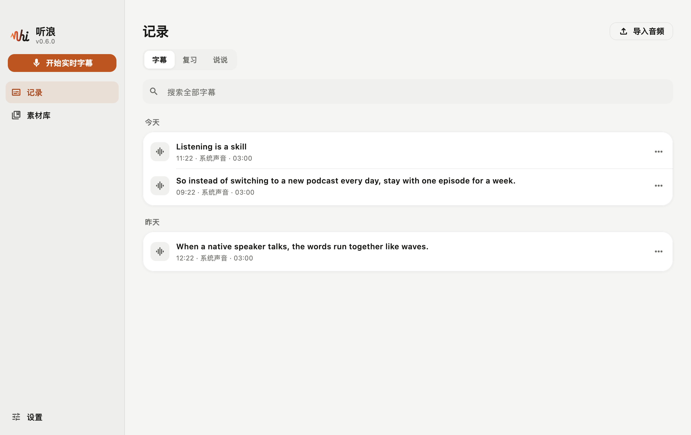
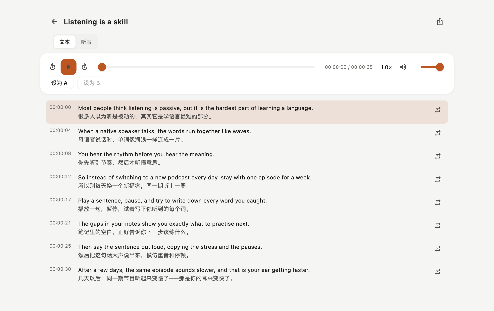
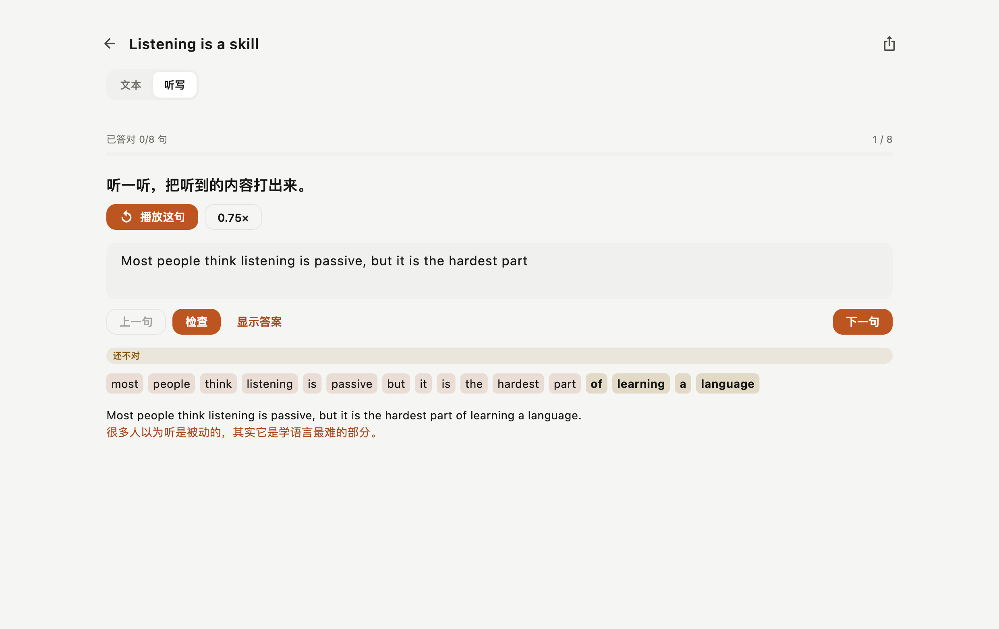
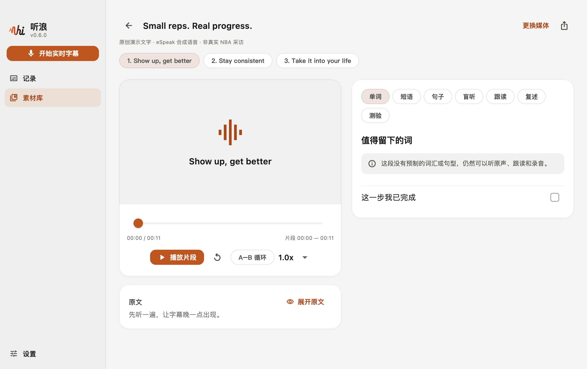
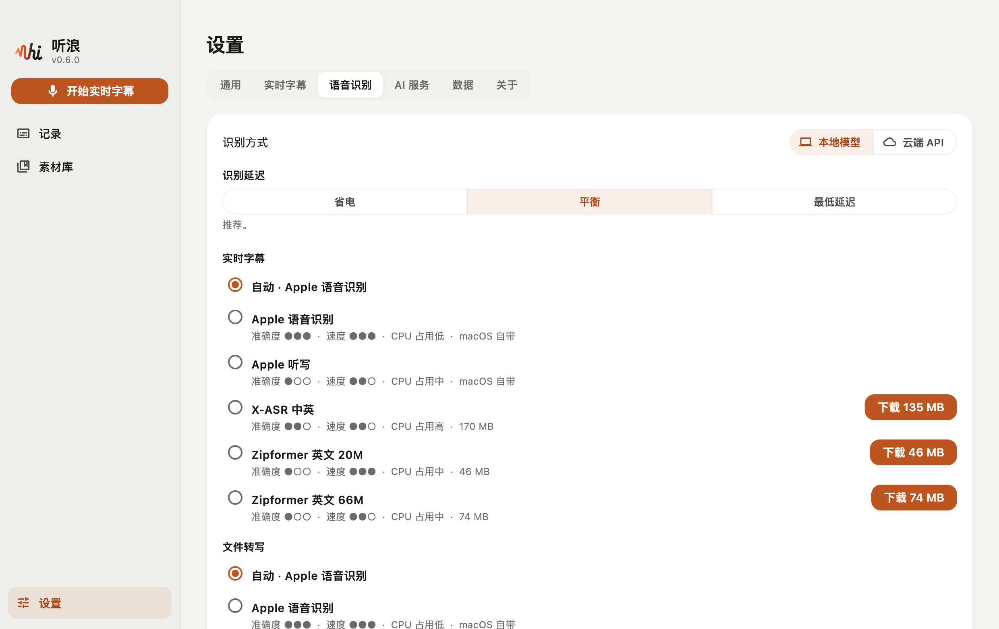
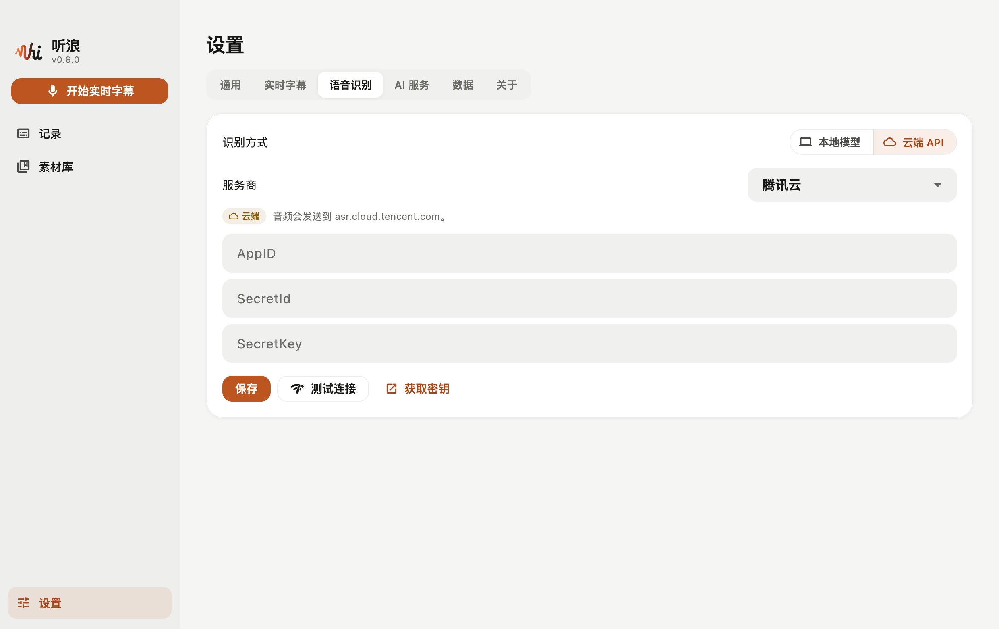
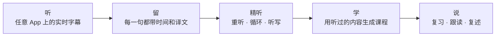

<div align="center">
  <picture>
    <source media="(prefers-color-scheme: dark)" srcset="../assets/brand/svg/tinglang-mark-dark.svg">
    
  </picture>
  <h1>听浪 · TingLang</h1>
  <p><strong>每一句都是一朵浪，接住它。</strong></p>
  <p>给 Mac 上播放的任何声音配实时双语字幕，再逐句精听、听写、生成自己的课程、开口说出来——素材就是你本来就在听的东西。</p>
  <p><a href="../README.md">English</a> · <strong>简体中文</strong></p>
  <p>
    <a href="https://github.com/eeeease/TingLang/releases/latest"></a>
    
    <a href="#许可"></a>
    
  </p>
  <p>
    <a href="#-功能">功能</a> ·
    <a href="#-下载安装">下载</a> ·
    <a href="#-隐私与数据">隐私</a> ·
    <a href="../docs/BUILDING.md">从源码构建</a> ·
    <a href="../docs/KNOWN_LIMITATIONS.md">已知限制</a>
  </p>
</div>

---

## 🌊 为什么叫「听浪」

**听浪，听的是声音的浪。** 声音以波的形式传播，英语也是这样一浪接一浪地涌向你：播客、球赛、游戏、电影、会议……大多一闪而过，来不及听清。

听浪替你把这些浪花接住。一个小小的悬浮窗，把 Mac 上正在播放的声音变成实时字幕，每句下面带着翻译，并把每一句都留下来。之后你可以一浪一浪地重听，凭记忆听写，生成一份自己的小课程，再用自己的话说出来——直到有一天，同一期节目听起来慢了下来。不是别人说慢了，是你的耳朵变快了。

说得直白一点：听浪是一款 Mac 上的英语学习 App，学的就是你本来在听的内容。它本地优先，不需要账号，没有任何统计；语音识别在你的 Mac 上完成，Mac 跑不动本地模型时，也可以用你自己的密钥接入云端服务。

## 📸 截图

<table>
  <tr>
    <td align="center"><br><sub>每次字幕都按句留下</sub></td>
    <td align="center"><br><sub>逐句精听，对照译文</sub></td>
  </tr>
  <tr>
    <td align="center"><br><sub>听写，逐词批改</sub></td>
    <td align="center"><br><sub>用听过的内容生成课程</sub></td>
  </tr>
  <tr>
    <td align="center"><br><sub>本地模型，按准确度、速度和 CPU 占用评级</sub></td>
    <td align="center"><br><sub>也可以用自己的密钥接入云端 API</sub></td>
  </tr>
</table>

## ✨ 功能

- 🌊 **任何声音都能上双语字幕**：系统声音或麦克风，悬浮窗浮在所有 App 和全屏视频上方。卡片或桌面歌词样式，上下或左右对照排列，锁定后点击穿透，还能往回翻。⌘⇧T 开始和停止。
- 🎧 **逐句精听**：每次字幕都按句保存，带时间和译文（愿意的话连同音频）。重听、0.6–1.5 倍速、A–B 循环，点一句就跳过去；全文搜索；导出 SRT、VTT、TXT。
- ✍️ **会批改的听写**：把听到的打出来，每句判为正确、接近或错误，并逐词对比。
- 🧩 **用听过的内容生成课程**：一键挑出超出你水平的生词、短语、盲听挖空、跟读段落、复述提纲和小测验。基础课程完全离线生成；AI 课程用你添加的服务商（18 个预设，含本机的 Ollama 和 LM Studio），开始前先估算费用，所有引用都与原文逐字核对。
- 🔁 **间隔复习**：收藏的表达按 FSRS-6 在快要忘记前回到你面前。
- 🗣️ **自己开口说**：录下自己的表达，和原声对比，记下笔记。
- 🔒 **在本机识别，或用你自己的云端**：macOS 26 用 Apple 语音识别；macOS 14.2 起可下载开源模型（标明准确度、速度和 CPU 占用）；也可以用自己的密钥接入云端 API——腾讯云、阿里云百炼、讯飞开放平台、Soniox、AssemblyAI、Azure 语音。
- 📦 **听浪包**：把课程连同音频、或一段录音打包成一个 `.tinglang` 文件发给朋友，双击即可导入。
- ☁️ **iCloud 云盘同步**（默认关闭）：同一 Apple ID 的每台 Mac 上都有你的素材和学习进度；同步由 macOS 完成，数据库不离开你的 Mac。
- 👤 **可选的听浪账号**：用邮箱、Google 或 GitHub 登录，查看套餐和用量；套餐在 [tinglang.app](https://tinglang.app) 购买和管理。听浪官方云端转写敬请期待。
- 🔄 **App 内更新**：有新版本时，点横幅上的按钮即可更新并重新打开（每天的检查可以关闭）。
- 📱 **iPhone 语音备忘录**：手机上的录音会出现在这里，按录制时间转写。
- 🌐 中英文界面。

## 🧠 怎么练



## 📥 下载安装

在[最新版本](https://github.com/eeeease/TingLang/releases/latest)下载 `Tinglang-<版本>-macOS.zip`，解压后把 **Tinglang** 拖进「应用程序」。支持 macOS 14.2 或更高版本，Apple 芯片和 Intel 芯片都可以。

App 目前还没有签名和公证，第一次打开会被 macOS 拦下。先尝试打开一次，再到 **系统设置 → 隐私与安全性 → 仍要打开**（或在终端运行 `xattr -dr com.apple.quarantine /Applications/Tinglang.app`）。每个版本都列出了 zip 的 SHA-256，可以用 `shasum -a 256` 核对。之后有新版本时，听浪会提醒你，并可以替你安装（安装前先核对 zip 的 SHA-256）。

### 第一次打开

只会出现悬浮窗。播放一段英文内容，点橙色录音键（或按 ⌘⇧T）。如果还没有能用的识别方式，听浪会请你在 设置 → 语音识别 里选一种：本地模型（下载一次）或云端 API。第一次还会请求录制系统声音的权限。停止后点 **查看**，打开逐句精听页；点 Dock 图标打开主窗口。

想看示例课程：**素材库 → 我的 → 加载示例课程**。示例是原创文字配约 36 秒合成语音，不是任何人的真实采访，也不是有版权的视频。

## 🛠 从源码构建

需要 macOS 14.2 或更高版本、Xcode 26 或更高版本、[fvm](https://fvm.app) 和 Python 3.10+。

```bash
git clone https://github.com/eeeease/TingLang.git
cd TingLang
fvm install
bash scripts/run_macos.sh
```

工具链细节、用自己的开发者团队签名、检查、版本号和发布流程，见 [docs/BUILDING.md](../docs/BUILDING.md)。在 Mac 上实际构建、运行过哪些检查，以及哪些还没做，都记在 [docs/VERIFICATION.md](../docs/VERIFICATION.md)。

## 🔐 隐私与数据

- 所有数据都在 Mac 上的一个文件夹里，具体路径以「设置」中显示的为准：

  ```text
  ~/Library/Application Support/dev.eeeease.tinglang/Tinglang/
  ├── tinglang.sqlite  # 记录、课程、草稿、练习、复习、设置
  ├── media/           # 拷贝进 App 的媒体
  ├── models/          # 你下载的识别模型（可在设置里删除）
  └── recordings/      # 你自己的录音（WAV）
  ```

- 除了下面的检查更新，听浪只在你打开了相应功能时联网，并在使用处标注：你选择的云端识别服务（音频会发给该服务商）、你添加的 AI 服务（生成课程或测试连接时）、你同意下载的识别模型、官方嵌入播放器里的 YouTube 片段，以及你登录之后的听浪服务器。密钥保存在 macOS 钥匙串中。
- **检查更新（默认开启）**：听浪每天向 GitHub（api.github.com）询问一次是否有新版本，请求里只有 App 的版本号（和访问任何网站一样，GitHub 能看到你的 IP 地址）。只有你点 **更新并重新打开** 时，才会从 GitHub 下载新版本。可以在 **设置 → 通用** 里关闭。
- 不需要账号，也没有任何统计。可选的云端账号只有在你登录后才会连接服务器；官方服务器还没有开放（[docs/CLOUD.md](../docs/CLOUD.md)）。
- 备份时先退出听浪，再复制整个文件夹。Markdown 导出不是备份。

## 🗺 暂未支持

发音评分、从视频网站下载、分享服务器与「发现」内容、在课程里编辑字幕、Windows 与手机、签名和公证的安装包。云端识别的适配按各家官方文档实现，但还没有用真实账号跑过。详见[已知限制](../docs/KNOWN_LIMITATIONS.md)。

## 📚 文档

| | |
| --- | --- |
| [BUILDING](../docs/BUILDING.md) | 工具链、运行、检查、版本号与发布 |
| [ARCHITECTURE](../docs/ARCHITECTURE.md) | App 的整体结构 |
| [COURSES](../docs/COURSES.md) | 课程与字幕格式 |
| [BRAND](../docs/BRAND.md) | 名称、配色、标志 |
| [TESTING](../docs/TESTING.md) · [VERIFICATION](../docs/VERIFICATION.md) | 要测什么，以及实际跑过什么 |
| [KNOWN_LIMITATIONS](../docs/KNOWN_LIMITATIONS.md) | 还不能用的部分 |

以上文档目前只有英文版。

## 🤝 参与贡献

欢迎提 Issue 和 Pull Request。请先读 [CONTRIBUTING.md](../CONTRIBUTING.md)（本地优先的基本规则、要跑的检查、贡献的许可条款）和 [AGENTS.md](../AGENTS.md)（对人同样适用）。安全问题请按 [SECURITY.md](../SECURITY.md) 私下报告。

## 许可

听浪采用双授权：

- **开源**：[GNU AGPL v3.0 only](../LICENSE)。可以自由使用、学习、修改和分发，也可以商用，前提是遵守 AGPL：凡是分发出去、或通过网络提供给别人使用的版本，都必须以 AGPL 公开完整源代码。
- **商业授权**：不能满足 AGPL 的用途（闭源产品、上架应用商店、不公开源码的托管服务等），需要向版权所有者 [@eeeease](https://github.com/eeeease) 另行获得商业授权，请在使用前联系。

贡献按 [CONTRIBUTING.md](../CONTRIBUTING.md) 中的条款接收。取自其他项目的代码和数据保留原有声明，见 [NOTICE.md](../NOTICE.md)。名称和标志是独立设计（[docs/BRAND.md](../docs/BRAND.md)）。课程素材的权利与软件许可分开处理：公开可看不等于可以再分发。

## 🙏 致谢

听浪站在两个开源项目的肩膀上：

- **[SubFlow](https://github.com/Jinsong-Zhou/subflow)**（Jinsong Zhou，MIT）——一款 macOS 菜单栏 App，把英文语音实时转写并翻译成中文。听浪的悬浮字幕窗、系统声音采集缓冲、Apple 翻译调度和全局快捷键，都从 SubFlow 的代码起步；移植的文件保留了它的 MIT 声明。
- **[Echo-Loop](https://github.com/echo-loop/Echo-Loop)**（AGPL-3.0）——一款以精听、跟读、盲听、复述和间隔复习为核心的英语听说训练 App。听浪的练习闭环沿用了同样的方法。当前源码中不包含 Echo-Loop 的代码。

也感谢 [NOTICE.md](../NOTICE.md) 和 App 内许可页面里列出的项目，包括 sherpa-onnx、media_kit、drift、ECDICT 和 LiteLLM 的模型目录。
